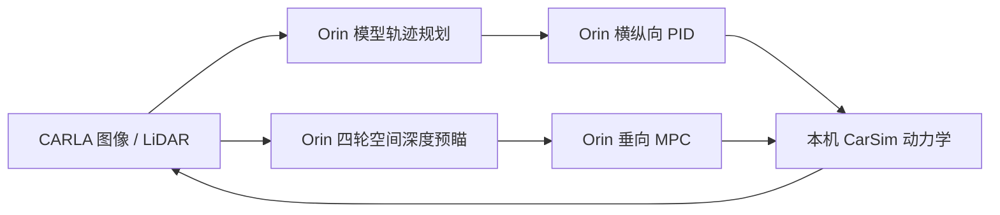

# Orin 自动驾驶与主动悬架联合仿真

本入口将 TransFuser、TCP、Qwen-Drive 的真实权重推理接入原 CARLA–CarSim–Orin 框架。
三种模型通过同一个服务切换运行；横纵向 PID 和垂向 MPC 均在 Orin，CarSim 是车辆动力学的唯一求解器。
CARLA 负责图像、LiDAR、路面网格、场景和可视化。



## 已部署的模型

| 入口 | 版本与权重来源 | 输入 | 输出 |
| --- | --- | --- | --- |
| `transfuser` | 官方 CVPR2021 分支与官方权重 | 400×300 前视 RGB、真实 LiDAR、车速、导航目标点 | 4 点轨迹，点间隔 0.5 s |
| `tcp` | 官方模型结构，第三方复现权重 | 900×256 前视 RGB、车速、导航目标点、道路指令 | 轨迹分支的 4 点预测 |
| `qwen` | Qwen-Drive-1.0-4B 与官方 `planner-sft` | 三视角各 4 帧历史图像、16 个 10 Hz 历史状态、导航指令 | 50 点轨迹，点间隔 0.1 s |

代码版本、权重 SHA256 和出处保存在 `driving_models.json`。
TransFuser 使用 [CVPR2021 官方实现](https://github.com/autonomousvision/transfuser/tree/cvpr2021)，
没有混用 2022 分支的网络和权重。
TCP 使用 [明确标注为非官方复现的 checkpoint](https://huggingface.co/maxim-igenbergs/tcp-carla-repro)，
不能将其结果称为论文官方模型或排行榜提交的复现。
作者曾在 [官方 issue #23](https://github.com/OpenDriveLab/TCP/issues/23) 提供消融实验权重，旧链接现已不可用。
Qwen 接入 [官方规划 API](https://github.com/QwenLM/Qwen-Drive-1.0)，直接调用 SFT planning expert，未将 VQA 文本当作轨迹。

所有 checkpoint 使用严格参数匹配加载。离线初始化时跳过额外 ImageNet 下载，随后加载完整训练参数；缺少参数即失败。
TCP 的 Lightning checkpoint 使用受限反序列化和无行为的回调元数据类，未安装或执行旧 Lightning 训练环境。

## 启动与模型切换

先关闭当前仿真窗口，再从仓库根目录切换 Orin 模型。部署脚本在本机 base Python 中运行，需要 Paramiko。
它检查本地源代码版本和 checkpoint 哈希，更新独立用户服务，并等待模型权重加载完成。

```powershell
python carsim_mpc_quick/orin/deploy_driving_orin.py --planner transfuser
```

脚本会提示 SSH 密码。密码只用于当前连接，不保存在服务、仓库或配置文件。
把 `transfuser` 改为 `tcp` 或 `qwen` 即可切换；每次只运行一个模型。

可视化运行 100 m 半径的左弯和组合起伏路：

```powershell
.\carsim_mpc_quick\orin\start_environment_loop.ps1 -Planner transfuser -RoadProfile combined -RoadCurvature 0.01 -Seconds 6
```

`-RoadCurvature -0.01` 为右弯，`0` 为直道；只有程序生成的测试道路使用这个参数。
减速带、坑洼、波浪及组合路面分别是 `bump`、`pothole`、`wave`、`combined`。
`-NoVisualize` 可用于保存数据的无窗口测试。

Town03 使用现有 159 号起点，默认指令为沿当前车道继续行驶：

```powershell
.\carsim_mpc_quick\orin\start_environment_loop.ps1 -Planner qwen -RoadProfile town -Seconds 2
```

`-NavCommand left/right/straight` 提供下一路口的导航意图。
`-CruiseKph 40` 将纵向 PID 目标显式设为 40 km/h；默认仍跟踪模型轨迹给出的速度。
该巡航设定保留模型停车和无效轨迹停车处理，不能作为交通规则安全层。
城市巡航命令模板（先保持 CarSim Browser 运行；严格模式可能因未分类几何提前中止）：

```powershell
.\carsim_mpc_quick\orin\start_environment_loop.ps1 -Planner tcp -Town Town05 -SpawnIndex 236 -RoadProfile town -CruiseKph 40 -Seconds 30
```

单车城市入口支持最长 120 s，并相应延长 CarSim 求解终止时间。程序测试道路仍限制为 13 s。
城市中部分射线命中返回未分类 `NONE`，严格默认模式会中止运行。
`-UnknownContact record` 是可选的不完整碰撞演示模式：保留已分类物体的正向接触反馈，
未分类命中只记录而不施加碰撞力，报告保存计数和最多 200 条样本。
该选项不能用于宣称完整碰撞验证；默认 `stop` 行为保持不变。
TCP/TransFuser 的目标点来自 CARLA 道路拓扑，模型仍负责预测轨迹；没有用拓扑轨迹替代神经网络输出。
该入口提供局部道路导航提示，尚未实现指定目的地的全局路线管理。
局部目标沿相连车道游标推进，避免在路口重新按最近道路匹配时跳到横向或反向车道。

本机缓存位于 `results/autodrive_bootstrap_20261027/sources/`。
部署脚本默认复用该缓存；若迁移机器，先恢复其中固定版本的源代码与权重，或用 `--cache` 指向同一结构的缓存。
权重不纳入 Git。

## 板端布局

- `suspension-driving.service`：55003，真实模型推理，生产文件在 `/home/nvidia/suspension_control/driving/`。
- `suspension-environment.service`：55002，深度预瞄、垂向 MPC、共享横纵向 PID。
- `suspension-mpc.service`：原 55001 MPC 接口。
- 模型 Python：`/mnt/nvme/qwen-drive/environments/qwen-drive-py312/bin/python`。
- Qwen 权重和官方代码复用 NVMe 上已验证的现有安装；独立编译缓存放在 driving 服务自己的目录。

现有 NVMe 已挂载到 `/mnt/nvme`，并添加 UUID 持久挂载项。
原 `/etc/fstab` 备份为 `/etc/fstab.suspension-autodrive-20261027.bak`。没有格式化磁盘，也没有替换原 MPC Python 依赖。
服务已启用；本次未通过重启设备验证启动顺序。

## 时钟、物理量和控制边界

CarSim 积分步长 1 ms，PID/MPC 每 10 ms 仿真时间更新；CARLA 相机每 50 ms 更新；模型每 200 ms 仿真时间规划。
这是离线同步仿真：推理期间仿真时钟暂停，GUI 仍可响应。100 Hz 的仿真步长不代表已经满足 10 ms 实时时限。
Qwen 首次调用包含内核编译和预热，可能需要数十秒；稳定推理仍需数秒。

统一轨迹坐标为米和弧度：X 向前、Y 向左、左转为正。
轨迹始终锚定在输入捕获时刻的车辆位姿，收到响应后不重置其时间戳。
旧轨迹、未来时间戳、耗尽轨迹、缺少规划及停车轨迹均触发停车控制。
模型 RPC 失败会停止本次仿真，保留错误与已完成数据，没有固定路线或固定车速接管。

CarSim 保留原 8 个悬架导入及 77 个输出。
驾驶模式追加方向盘角度（deg）、油门（0–1）、四个制动执行器压力（MPa）；接触力启用时仍追加纵向外力。
姿态输出后另追加 `Vy_SM`（km/h），真实横向速度参与模型状态历史。
当前方向盘换算比 16、最大制动压力 6 MPa 及 PID 增益属于初始集成标定，不是经过车辆参数辨识后的最终参数。

驾驶模式的垂向预瞄沿四个轮胎的短时转向轨迹在深度点云上取样，使用实测轮胎位置、当前位姿、速度及指令曲率。
它保留坡面参考系校正，并把左右轮路高汇总到原半车 MPC；没有引入解析测试路高作为预瞄。
缺少四轮图像覆盖时仍使用原预瞄预热监督。

## 验证与局限

`check_driving.py --carsim` 验证真实 DLL 的左右转向、油门、制动输入；每种输入在独立进程内初始化。
`check_driving.py --spatial-preview` 验证 0°、45°、90°方向下的空间预瞄几何。
主项目验证命令仍是 `python scripts/check_project.py`，不使用 pytest。
具体报告和每次模型响应位于 `results/carla_environment/<时间戳>/`；`first_driving_request.json` 保存可复核的真实传感器输入。

2026-10-27 集成记录如下，汇总文件为 `results/autodrive_bootstrap_20261027/validation_summary.json`：

| 路线 | 报告目录 | 实际神经网络控制 | 预热后推理中位数 | 本次最大车道横向偏差 |
| --- | --- | --- | --- | --- |
| TransFuser | `20261027_230301` | 左弯组合路，600 步 / 6 s | 100.6 ms | 0.199 m |
| TCP 复现 | `20261027_223101` | 右弯组合路，600 步 / 6 s | 61.9 ms | 0.264 m |
| Qwen SFT | `20261027_223938` | Town03，历史采集后 40 步 / 0.4 s | 3927 ms，仅一个热调用 | 0.002 m，主要为低速/停车 |

Qwen 该次完整仿真为 2 s，其中前 1.6 s 收集真实历史，缺少轨迹时按停车处理；首次模型调用另耗时 74.9 s。
各模型的输入、速度、路况和运行长度不同，上表不能作为算法优劣对比。
新旧默认 CarSim 悬架模式的 100 步 / 81 维状态逐项完全一致；旧直行深度预瞄 15 步对照误差为零。
空间预瞄几何检查的最大高度误差为 0.25 mm；这只验证几何计算，不代表真实相机路面测量精度。
MPC 的 80 组 MATLAB 对照最大力误差为 `7.96e-13 N`，主项目 `check_project.py` 七项检查通过。

短时闭环通过仅说明接口、坐标、状态、模型推理及动力学链路可运行。
Qwen 在空白程序道路上可能持续预测停车，不能据此宣称自动驾驶成功或模型性能优于其他路线。
当前缺少长路线、交通规则、拥堵和复杂路口的系统评测，也没有满足硬件在环实时性。
碰撞继承原正向柔顺接触原型，完整 PhysX 冲量和转弯斜碰/侧碰尚未实现。
半车 MPC 优化垂向和俯仰，未增加主动侧倾控制。

原 `-Compare` 入口继续提供 MPC/被动悬架双车对照；自动驾驶模型当前接入单车入口。
