# active_suspension_midterm_defense_20260622_214542

- Source: `active_suspension_midterm_defense_20260622_214542.pptx`
- Total slides: 16

## Slide 1

哈尔滨工业大学航天学院 2024级硕士 中期答辩

- 基于道路预瞄信息的
- 主动悬架控制策略研究

- 学 科：控制科学与工程
- 导 师：周洪亮
- 学生学号：24S004091
- 学生姓名：张甜雨
- 汇报日期：2026年6月22日

### Speaker Notes

各位老师好，我汇报的题目是基于道路预瞄信息的主动悬架控制策略研究。中期阶段重点围绕模型、控制方法、仿真验证和后续计划四个方面展开。

## Slide 2

- 中期汇报主线
- 从模型与基线到两条控制方法，再到阶段实验和后续计划

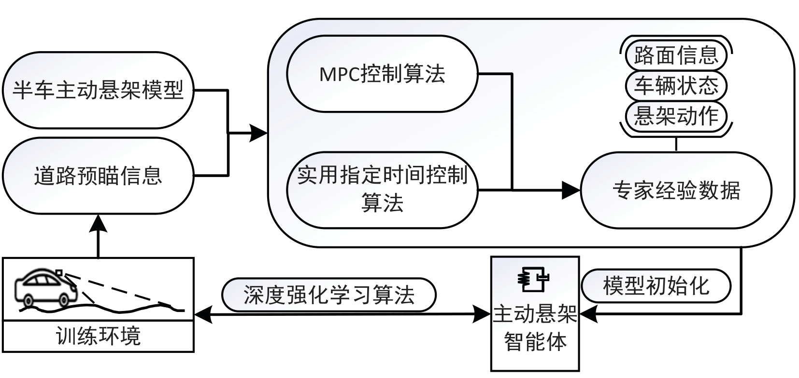

汇报内容

目标：面向道路预瞄信息，形成安全、高效、可解释的主动悬架控制策略

- 1. 研究进度概况：已完成半车模型、道路预瞄建模、基线控制器与仿真平台
- 2. SPDF 周期滞后滑模控制：完成理论设计与实验验证，相关成果已在 IJRNC 发表
- 3. SI-RPPO 安全教师门控 PPO：完成网络、门控、约束反馈与阶段对比实验
- 4. 问题与计划：补充鲁棒性、能耗-舒适性权衡、预瞄误差与硬件在环验证

中期重点：证明课题按计划推进，并明确下一阶段实验闭环。

### Speaker Notes

这一页先给出汇报主线。中期答辩的重点不是重新展开全部文献，而是说明课题是否按计划推进、已经完成了哪些方法和实验，以及下一阶段如何收敛到论文目标。

## Slide 3

学术研究进度与已完成工作

| 阶段 | 时间 | 主要内容 | 状态 | 完成度 |
| --- | --- | --- | --- | --- |
| 模型与路况 | 2025.09-12 | 非线性半车模型、ISO/凸包路面与评价指标 | 已完成 | 100% |
| SPDF 控制 | 2025.12-2026.03 | 周期滞后滑模面、连续控制律与稳定性证明 | 已完成 | 100% |
| 论文成果 | 2026.01-05 | SPDF 成果发表于 IJRNC（JCR Q1） | 已完成 | 100% |
| 仿真平台 | 2026.03-05 | PID/SPDF/MPC/PPO 基线与闭环评估脚本 | 已完成 | 100% |
| SI-RPPO | 2026.04-06 | Transformer预瞄编码、安全教师门控与动作约束 | 初版完成 | 80% |
| 阶段实验 | 2026.05-06 | 7类路况、6种方法、多指标横向对比 | 阶段完成 | 80% |
| 消融实验 | 2026.06 | SI-RPPO 与 PPO scratch 对比 | 阶段完成 | 70% |
| MPC整定 | 2026.06-08 | 归一化权重、多目标搜索与专家数据改进 | 进行中 | 50% |
| 预瞄鲁棒性 | 2026.08-10 | 噪声、时延、截断与缺失建模 | 计划中 | 0% |
| HIL/实车准备 | 2026.10-2027.01 | 实时性、安全性与论文撰写 | 计划中 | 0% |

阶段成果：SPDF 方法论文已在 International Journal of Robust and Nonlinear Control（JCR Q1）发表；SI-RPPO 完成半车仿真闭环与初步对比。

### Speaker Notes

自开题以来，课题已经从模型搭建推进到两类控制器实现和阶段性横向对比。当前进度整体与中期计划基本一致，其中SPDF主线已经形成论文成果，SI-RPPO主线完成了半车仿真闭环和初步消融。

## Slide 4

模型、指标与预瞄接口

四自由度半车主动悬架

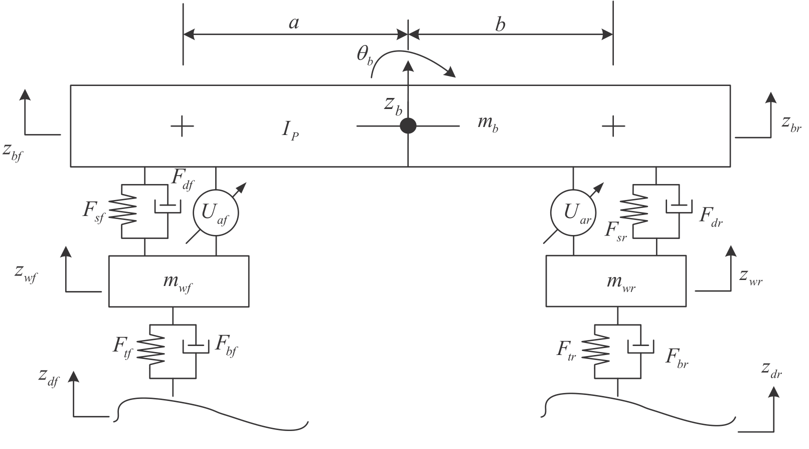

建立非线性半车模型，并纳入悬架行程、轮胎动载荷和执行器力限幅约束。

评价指标覆盖舒适性、安全性和能耗

- 舒适性：车身垂向加速度 RMS、俯仰角加速度 RMS
- 安全性：悬架动行程峰值、轮胎动载荷 RMS
- 能耗：控制力峰值与控制能耗

道路预瞄序列作为控制输入接口，支撑 MPC 基线与 SI-RPPO 策略网络。

### Speaker Notes

研究对象是四自由度非线性半车主动悬架。评价时不只看舒适性，还同步检查悬架行程、轮胎动载荷、执行器力和控制能耗，保证后续算法比较在同一约束框架下进行。

## Slide 5

两条控制方法主线

模型控制 + 预瞄强化学习

SI-RPPO 控制

SPDF 控制

- 周期滞后滑模面
- 连续切换函数抑制抖振
实用指定时间收敛

- Transformer 道路预瞄编码
- 安全教师门控
动作可行性约束反馈

7类典型路况与多控制器对比

统一仿真平台

用被动、PID、SPDF、MPC、PPO scratch 作为对照，评估舒适性、安全性、能耗与动作平滑性。

7类路况 / 6种方法 / 多指标评价

### Speaker Notes

在控制方法上，中期阶段形成了两条并列主线。SPDF提供可解释、可证明的模型控制基线；SI-RPPO则面向道路预瞄利用和复杂工况泛化，强调训练效率与安全约束。

## Slide 6

SPDF：周期滞后滑模控制方法

面向模型已知情形，实现垂向与俯仰误差的实用指定时间收敛

构造周期滞后滑模变量，将当前误差与滞后误差共同纳入滑模面。

h

设计连续滑模控制律，避免传统符号切换导致的高频抖振。

周期滞后反馈

Lyapunov 稳定性证明

误差系统

稳定性证明

### Speaker Notes

SPDF方法的核心是把周期滞后反馈引入滑模面，使误差在指定时间附近快速收敛。为了降低工程实现中的抖振风险，控制律采用连续切换形式，并通过Lyapunov分析给出稳定性论证。

## Slide 7

SPDF 阶段结果

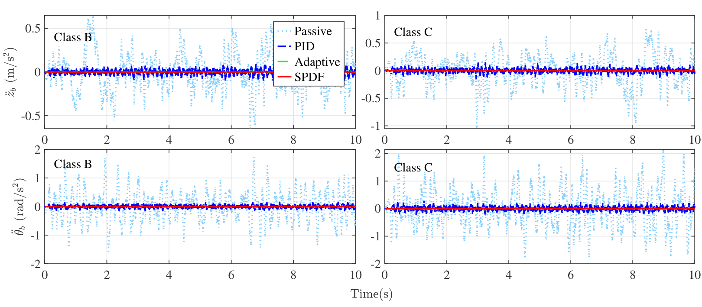

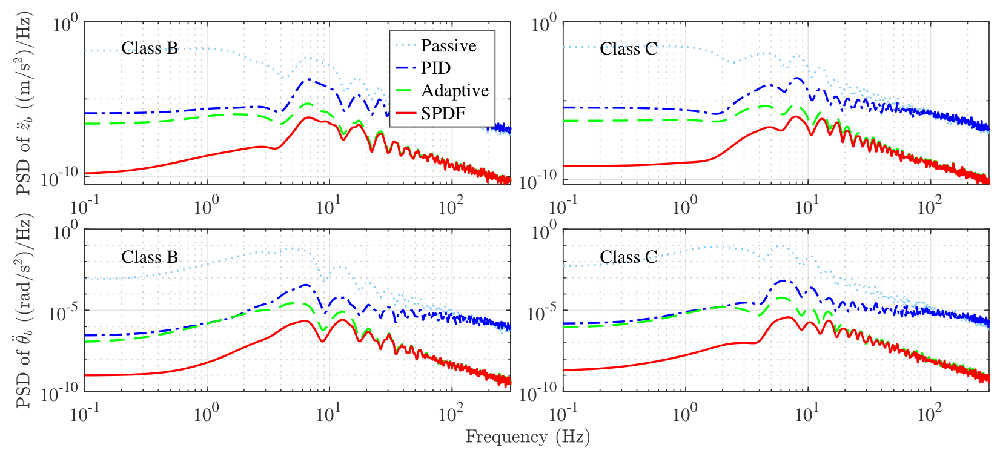

强
高

ISO B/C 与凸包

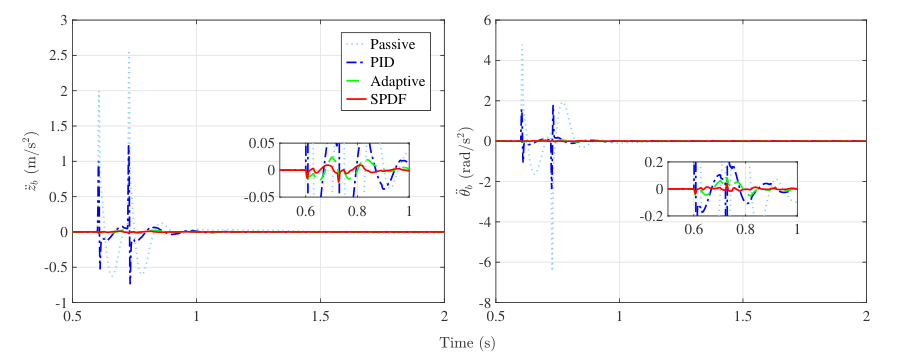

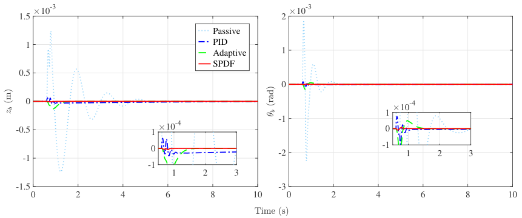

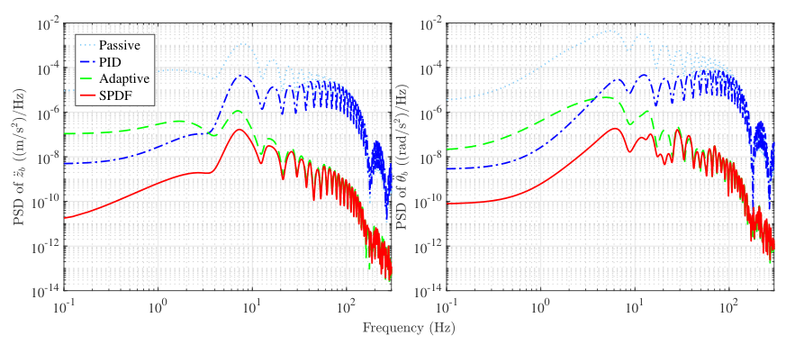

### Speaker Notes

阶段实验表明，SPDF在车身振动抑制上最突出，尤其是车身加速度和俯仰加速度指标。它的代价也比较清楚，即控制力峰值和能耗相对较高，这为后续能耗和舒适性折中研究留下了空间。

## Slide 8

SI-RPPO：安全教师门控与动作可行性约束反馈

在道路预瞄信息可用条件下，采用 PPO 在线更新；策略网络以车辆状态和未来路面高程序列为输入，直接输出候选主动控制力。

状态

SPDF 安全教师轨迹

预瞄

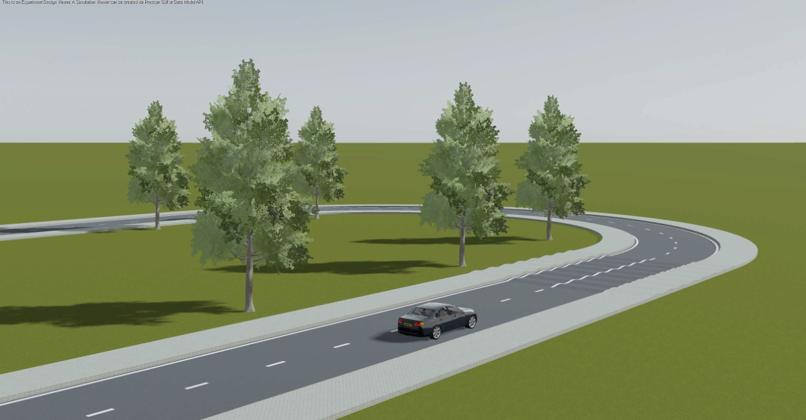

路面编码

状态编码

- actor 输出候选控制力
- critic 评估状态价值

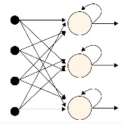

PPO 更新

离线行为克隆初始化提升训练起点；状态相关门控决定是否偏离安全教师；动作屏蔽层统一处理幅值、变化率与安全裕度。

核心思想：训练阶段借助 SPDF 先验，部署阶段不需要在线运行复杂专家控制器，仍在执行器可行域内输出平滑控制力。

### Speaker Notes

第二条主线是SI-RPPO。它不是让强化学习从随机动作盲目探索，而是先利用SPDF教师轨迹进行行为克隆，再在PPO在线训练中加入安全门控和动作可行性反馈。

## Slide 9

从 PPO scratch 到 SI-RPPO

PPO scratch 从随机策略探索，样本效率低，容易出现执行器饱和与不安全动作。

→

目标是在安全可行范围内，用可解释的主动控制力换取舒适性提升。

离线示教初始化：利用 SPDF 轨迹进行行为克隆，使策略初始位于合理主动控制动作附近。

安全教师门控 + 约束反馈

在线训练阶段显式惩罚约束修正量、不安全状态和动作突变；执行阶段按幅值、变化率和安全裕度修正控制力。

### Speaker Notes

从标准PPO到SI-RPPO，主要改动集中在训练起点、安全动作和状态相关门控三个方面。这样做的目的，是在不牺牲安全可行域的前提下，让策略更快学到有意义的主动减振动作。

## Slide 10

统一仿真框架与对比基线

模型与路况

四自由度非线性半车模型；ISO B/C 随机路面、正弦、凸包、阶跃、凹坑与复合路面。

控制器基线

| 方法 | 角色 | 当前状态 |
| --- | --- | --- |
| 被动 / PID | 低复杂度对照 | 已完成 |
| SPDF | 模型控制主线 | 已完成并发表 |
| MPC | 结构化预瞄基线 | 已接入，权重待整定 |
| PPO / SI-RPPO | 强化学习主线 | 完成阶段实验 |

评价指标

舒适性：车身垂向与俯仰加速度 RMS

安全性：悬架动行程、轮胎动载荷、约束违背

能耗与平滑性：控制力峰值、能耗、动作变化率

### Speaker Notes

为了让各方法具有可比性，我把模型、路面、基线控制器和指标都放在统一仿真框架中。当前阶段完成了七类路况和六种控制方法的横向对比，后续主要继续提高MPC和SI-RPPO的调参质量。

## Slide 11

阶段性实验：六种方法全指标均值

| 指标 | 被动 | PPO scratch | SI-RPPO | SPDF |
| --- | --- | --- | --- | --- |
| 回合回报 | -869 | -762 | -578 | -9104 |
| 车身加速度RMS | 0.330 | 0.274 | 0.203 | 0.013 |
| 俯仰加速度RMS | 1.276 | 1.192 | 0.659 | 0.047 |
| 最大前悬架行程 | 0.032 | 0.034 | 0.035 | 0.050 |
| 最大后悬架行程 | 0.034 | 0.032 | 0.036 | 0.052 |
| 前轮胎动载荷RMS | 971 | 939 | 973 | 1131 |
| 后轮胎动载荷RMS | 1164 | 1130 | 1166 | 1241 |
| 控制力峰值 | 0 | 345 | 767 | 1683 |
| 控制能耗 | 0 | 461 | 1585 | 3372 |
| 不安全步数/门控 | 0 / -- | 0 / -- | 0 / 0.353 | 0 / -- |

结论：SPDF 对车身振动抑制最强；SI-RPPO 相比 PPO scratch 在回报和舒适性上显著改善，当前代价是主动控制能耗更高。

### Speaker Notes

这一页是阶段结果的核心表格。可以看到SPDF的车身加速度RMS最低，而SI-RPPO相较PPO scratch显著改善回报和舒适性；当前SI-RPPO的主要代价是控制能耗上升。

## Slide 12

SI-RPPO 消融与门控行为

示教初始化 + 安全门控带来舒适性收益

| 指标 | PPO scratch | SI-RPPO | 改善 |
| --- | --- | --- | --- |
| 最终评估回报 | -761.55 | -577.97 | 提升 |
| 车身加速度RMS | 0.274 | 0.203 | 降低25.8% |

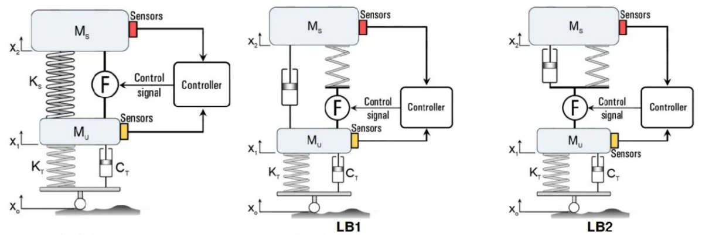

最终回报：-762 → -578

能耗权衡待整定

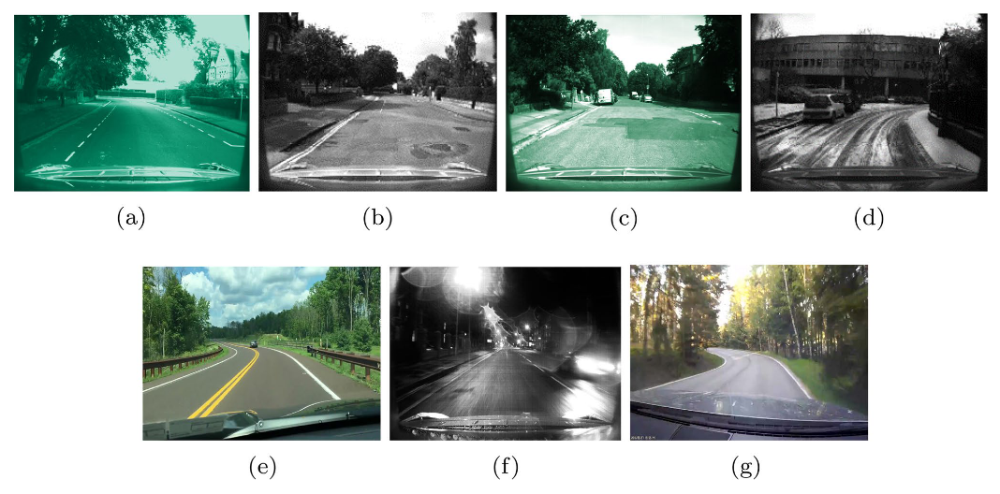

| 指标 | PPO scratch | SI-RPPO | 说明 |
| --- | --- | --- | --- |
| 俯仰加速度RMS | 1.192 | 0.659 | 降低44.7% |
| 控制能耗(J) | 461 | 1585 | 主动用力换舒适性 |

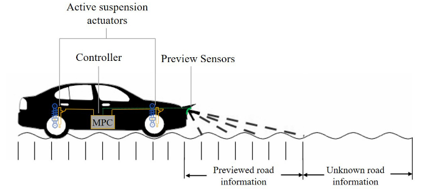

平均门控系数约 0.353

### Speaker Notes

消融对比说明，示教初始化和安全门控确实提升了策略的舒适性收益。SI-RPPO的最终回报从约负七百六十二提升到约负五百七十八，同时车身和俯仰加速度RMS明显降低。

## Slide 13

阶段性结论

- 1. 研究进度：模型、道路预瞄接口、仿真框架、基线控制器与 SI-RPPO 初版均已完成。
- 2. SPDF：在振动抑制上表现最优，相关成果已发表于 IJRNC（JCR Q1）。
- 3. SI-RPPO：相较 PPO scratch，回报由 -762 提升到 -578，车身/俯仰加速度 RMS 分别下降约 25.8%/44.7%。
- 4. 下一步：聚焦能耗--舒适性权衡、预瞄误差鲁棒性与硬件在环验证。

### Speaker Notes

综合来看，中期阶段已经完成了从理论控制到强化学习控制的主要闭环。后续工作的关键，是把已有方法从阶段性有效推进到多工况、非理想预瞄和工程实时条件下仍然可靠。

## Slide 14

目前存在的问题

SPDF 对动力学模型、参数上界和执行器建模较敏感，面对强参数失配或真实感知误差时需进一步鲁棒性验证。

!

同时还需评估预瞄噪声、时延、空间采样误差与局部缺失对控制性能的影响。

MPC 作为结构化预瞄基线仍需权重整定和专家数据质量提升。

SI-RPPO 后续改进方向

当前 SI-RPPO 已提升回报与舒适性，但依赖更高主动能耗；需要系统搜索门控上限、示教强度和多目标权重。

### Speaker Notes

当前存在的问题也比较明确。SPDF需要进一步验证参数失配和感知误差下的鲁棒性；SI-RPPO还需要在舒适性收益和主动能耗之间找到更稳的折中。

## Slide 15

后续研究计划

| 时间 | 主要任务 | 输出 | 状态 | 目标 |
| --- | --- | --- | --- | --- |
| 2026.06-08 | 补充 SPDF 参数鲁棒性、MPC 权重整定与 SI-RPPO 优化 | 实验报告 | 进行中 | 方法定型 |
| 2026.08-10 | 构建非理想道路预瞄模型，分析噪声、时延、截断和缺失 | 鲁棒性分析 | 计划中 | 误差边界 |
| 2026.10-12 | 完成硬件在环或实车条件准备，开展实时性和安全性验证 | HIL/实时性结果 | 计划中 | 工程验证 |
| 2026.12-2027.01 | 汇总实验结果，撰写学位论文与相关学术论文 | 论文稿 | 计划中 | 答辩材料 |
|   |   |   |   |   |
|   |   |   |   |   |
|   |   |   |   |   |
|   |   |   |   |   |
|   |   |   |   |   |
|   |   |   |   |   |

计划原则：先补齐仿真闭环与参数整定，再把预瞄误差和实时验证纳入工程可用性评估。

### Speaker Notes

后续计划分为四个阶段。近期先完成参数鲁棒性、MPC权重和SI-RPPO多目标整定；随后把非理想预瞄信息纳入仿真，最后推进硬件在环或实车条件准备和论文写作。

## Slide 16

请各位老师批评指正

2026年6月

### Speaker Notes

以上是我的中期答辩汇报，请各位老师批评指正。
